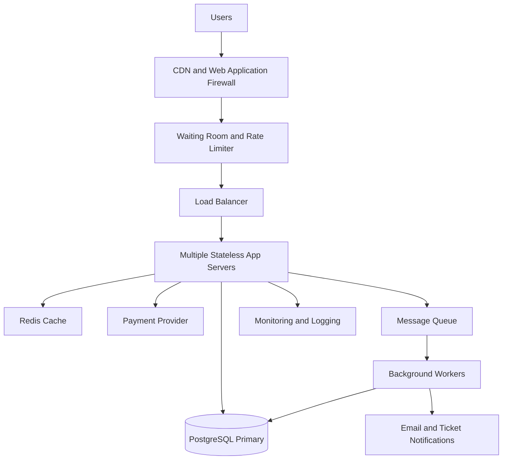

# TicketHub — System Design Document

## 1. Requirements

TicketHub is a website where users can browse concerts and events, select seats, purchase tickets, and view their orders. The system must remain reliable during popular ticket sales.

### Functional requirements

1. Users can register, log in, and manage their accounts.
2. Users can browse events and view event details.
3. Users can view a seating map and see which seats are available, held, or sold.
4. Users can temporarily hold available seats while completing checkout.
5. Users can pay for held seats and receive a booking confirmation.
6. Users can view their purchased tickets and order history.
7. Expired seat holds are released automatically.
8. The system prevents the same seat from being sold to two different customers.

### Non-functional requirements

- **Performance:** Event pages should load within 300 milliseconds at the 95th percentile under normal conditions. Seat availability and reservation requests should normally respond within 500 milliseconds at the 95th percentile, excluding external payment processing.
- **Correctness:** A seat must never be sold to more than one customer. Payments and bookings must remain consistent.
- **Fairness:** A waiting room should assign queue positions fairly and prevent users from gaining an advantage by repeatedly refreshing the page. Rate limits and bot protection should reduce automated abuse.
- **Availability:** Browsing should remain available during traffic spikes. If purchasing becomes temporarily unavailable, users should receive a clear message rather than an incorrect booking confirmation.
- **Scalability:** The system should handle normal traffic and sudden increases during popular concert sales.
- **Security:** Authentication, authorization, encrypted connections, secure payment processing, and rate limiting must protect users and transactions.

## 2. Traffic and Capacity Estimates

### Normal traffic

Given:

- Registered users: 2,000,000
- Daily visitors: 50,000
- Pages viewed per visitor: 10
- Tickets sold per day: 5,000

Calculations:

- Daily page views = 50,000 × 10 = **500,000 page views**
- Average page views per second = 500,000 ÷ 86,400 ≈ **5.8 page views/second**
- Average tickets sold per second = 5,000 ÷ 86,400 ≈ **0.058 tickets/second**

These are daily averages, so actual traffic will vary throughout the day.

### Popular concert sale

Given:

- People trying to buy tickets: 200,000
- Available seats: 20,000
- Time window: 10 minutes = 600 seconds

Calculations:

- Average purchase attempts per second = 200,000 ÷ 600 ≈ **333 attempts/second**
- Demand-to-capacity ratio = 200,000 ÷ 20,000 = **10 people per seat**
- Only 10% of the interested people can obtain a seat if everyone wants one seat and all 20,000 seats are sold.

For an additional capacity estimate, assume each buyer generates five API requests during the sale. This produces approximately 1,000,000 requests over 10 minutes, or **1,667 requests/second** on average. This is an assumption for planning, not a measured value.

### Comparison and response

The sale brings four times as many people as the entire normal day's visitors, concentrated into only ten minutes. The system must handle a much higher request rate than normal and protect the database from excessive concurrent reservation attempts.

I would use a waiting room, a load balancer, multiple application servers, caching for read-heavy content, and database transactions for seat reservations. Capacity should be tested under load before a major sale.

## 3. API Design

The API uses REST conventions and JSON request and response bodies. All endpoints use HTTPS.

| Method and endpoint            | Purpose                                         | Expected response                      |
| ------------------------------ | ----------------------------------------------- | -------------------------------------- |
| GET /events                    | Browse and search events                        | 200 OK                                 |
| GET /events/{eventId}          | View event details                              | 200 OK                                 |
| GET /events/{eventId}/seats    | View the seating map and seat status            | 200 OK                                 |
| POST /events/{eventId}/holds   | Request a temporary hold on selected seats      | 201 Created, or 409 Conflict           |
| POST /orders/{orderId}/payment | Pay for a pending order                         | 200 OK or an appropriate payment error |
| GET /me/tickets                | View the authenticated user's purchased tickets | 200 OK                                 |

### API behavior

- `GET /events` supports pagination and filters such as date, location, and category.
- `GET /events/{eventId}/seats` returns seat IDs, prices, and availability. Cached availability is for display only and is not a guarantee that a seat can be reserved.
- `POST /events/{eventId}/holds` requires authentication and a list of seat IDs. The server validates availability and creates a temporary hold, for example, for five minutes. It returns a hold ID and expiry time.
- `POST /orders/{orderId}/payment` verifies that the order belongs to the authenticated user and that the seat hold is still valid. Payment processing uses an idempotency key to avoid charging the customer twice when a request is retried.
- `GET /me/tickets` returns only tickets belonging to the authenticated user.

The API should return `400 Bad Request` for invalid input, `401 Unauthorized` for missing authentication, `403 Forbidden` for insufficient permissions, `404 Not Found` for missing resources, `409 Conflict` for unavailable seats, and `429 Too Many Requests` when rate limits are exceeded.

## 4. Data Model

A relational database such as PostgreSQL is appropriate because seat reservations and payments require strong consistency and transactional guarantees.

### Tables

**users**

- `id` — primary key
- `name`
- `email` — unique
- `password_hash`
- `created_at`

**events**

- `id` — primary key
- `title`
- `venue`
- `starts_at`
- `sale_starts_at`
- `status`

**seats**

- `id` — primary key
- `event_id` — foreign key referencing `events.id`
- `section`
- `row_number`
- `seat_number`
- `price`
- `status` — available, held, or sold
- `held_by_user_id` — nullable foreign key referencing `users.id`
- `hold_expires_at` — nullable timestamp

A unique constraint on `(event_id, section, row_number, seat_number)` prevents duplicate representations of the same seat for an event.

**orders**

- `id` — primary key
- `user_id` — foreign key referencing `users.id`
- `status` — pending, paid, failed, or cancelled
- `total_amount`
- `payment_reference` — nullable and unique when present
- `created_at`

**order_items**

- `id` — primary key
- `order_id` — foreign key referencing `orders.id`
- `seat_id` — foreign key referencing `seats.id`
- `price_paid`

A unique constraint on `order_items.seat_id` prevents a seat from appearing in two confirmed order records. Order items are inserted only when the booking is confirmed; expired or failed holds must not create confirmed order items.

### Relationships

- One user can have many orders.
- One event can have many seats.
- One user can temporarily hold multiple seats.
- One order can contain multiple order items.
- Each order item references one seat.

These relationships use primary keys and foreign keys to maintain data integrity.

## 5. Preventing Double-Booking

The database is the source of truth for seat ownership. A cached seat map must never be used as the final authority when confirming a reservation.

When a user requests seats, the application starts a database transaction and attempts an atomic conditional update. Conceptually, the update succeeds only if each requested seat is available or its previous hold has expired.

For example:

```sql
UPDATE seats
SET status = 'held',
    held_by_user_id = :user_id,
    hold_expires_at = CURRENT_TIMESTAMP + INTERVAL '5 minutes'
WHERE id = :seat_id
  AND (
    status = 'available'
    OR (
      status = 'held'
      AND hold_expires_at < CURRENT_TIMESTAMP
    )
  )
RETURNING id;
```

The application checks the number of rows returned. If any requested seat cannot be held, the transaction is rolled back so that the user does not receive only part of a multi-seat reservation.

The transaction commits only after all requested seats have been successfully held. Concurrent requests for the same seat cannot both successfully change that seat from available to held.

When payment succeeds, another transaction verifies that the hold is still valid and belongs to the buyer. It then marks the seats as sold, creates the confirmed order items, and updates the order status. A unique constraint on `order_items.seat_id` provides an additional safeguard against duplicate confirmed bookings.

Payment-provider webhooks must be verified and processed idempotently. If payment succeeds after a hold has expired, the system must not silently sell an already-reserved seat again; it must follow a defined recovery process, such as refunding the payment or initiating manual resolution.

Expired holds are released by a background worker, and a failed reservation transaction releases its changes through rollback.

## 6. Architecture Diagram



### Component explanations

1. **CDN and Web Application Firewall:** Serves static files close to users and filters suspicious traffic.
2. **Waiting room and rate limiter:** Controls the number of users entering the purchasing flow and applies fair queueing, rate limits, and bot protection.
3. **Load balancer:** Distributes requests across healthy application servers.
4. **Stateless application servers:** Handle authentication, event browsing, seat holds, orders, and payment coordination. More servers can be added during a sale.
5. **Redis cache:** Stores frequently accessed event details and other read-heavy data. It is not the authority for seat ownership.
6. **PostgreSQL primary:** Stores users, events, seats, and orders. Transactions, conditional updates, and constraints protect booking correctness.
7. **Payment provider:** Processes payments without storing raw card details in TicketHub.
8. **Message queue and background workers:** Process notifications and cleanup tasks asynchronously, reducing unnecessary work during checkout.
9. **Monitoring and logging:** Tracks latency, errors, queue length, database load, failed payments, and booking conflicts.

### Handling the big sale

The waiting room smooths the incoming traffic rather than allowing all 200,000 users to overwhelm the purchasing service at once. The CDN and Redis reduce database work for frequently requested event information. The load balancer distributes requests across application servers, while the database handles reservation changes through transactions.

The system should use connection pooling, database monitoring, load testing, and alerts. If demand exceeds safe capacity, it should slow admission to the purchasing flow rather than compromise booking correctness. Database replicas may serve eligible read-only queries, but seat reservations and final booking checks must use the authoritative database.

## 7. Trade-Offs

### Trade-off 1: Strong consistency versus performance

Using database transactions and conditional updates protects seat ownership, but concurrent reservations can create lock contention and increase latency. I would prioritize correctness over maximum write throughput because selling the same seat twice is unacceptable.

### Trade-off 2: Fairness versus speed of access

A waiting room reduces overload and gives users an orderly purchasing process, but it adds waiting time and operational complexity. A queue also cannot guarantee that everyone gets a ticket when demand exceeds supply. I would use a transparent queue policy, monitor abuse, and communicate expected waiting conditions clearly.

### Trade-off 3: Caching versus freshness

Caching event and seat-map information improves response times and reduces database load. However, cached seat availability can become stale during a sale. I would cache relatively stable event information aggressively and use the database to validate every seat hold and confirmed purchase.

## Conclusion

TicketHub is designed to support normal browsing and sudden ticket-sale traffic while preserving correctness and fairness. Horizontal scaling, a waiting room, caching, asynchronous background work, and careful capacity planning improve performance. Most importantly, atomic database updates, transactions, and unique constraints prevent double-booking.
